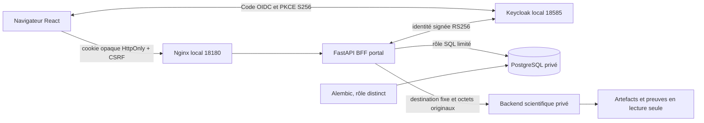

# Industrial Platform V3 — Sprint 1

État : implémentation locale pour revue. Aucune exposition Internet autorisée et aucun commit/push automatique. Le démonstrateur Studio 2.0 reste sur `http://localhost:18080`. Le portail industriel utilise `http://localhost:18180` ; le fournisseur local utilise `http://localhost:18585`.

## Audit de départ et séparation scientifique

Le démonstrateur existant donne directement accès aux inspections et conserve un historique local au navigateur. Il n'offre ni identité OIDC, ni autorisation par inspection, ni historique PostgreSQL. Ce comportement reste celui du démonstrateur historique. Le nouveau frontend est compilé avec `VITE_PORTAL_MODE=true` et passe exclusivement par le BFF.

Les fichiers Python de `src/`, `backend/app/` et `deployment/validate_portability.py` appartiennent aux empreintes de portabilité. Le nouveau service est indépendant, dans `services/portal/`. Il ne charge aucun checkpoint, ne transforme aucune image, ne choisit aucun seuil et ne modifie aucune calibration. Le moteur scientifique reste responsable de l'admission SHA256, des scores, décisions et explications. Les nouveaux fichiers métier sont hors du périmètre des empreintes scientifiques. `pyproject.toml` et `frontend/DESIGN.md` restent inchangés.

## Flux d'identité et sessions

L'administrateur du fournisseur provisionne les comptes et un seul rôle métier par compte. Aucune inscription publique, aucun mot de passe traité par React/BFF et aucun grant OAuth implicite ou password. Le générateur local crée des identifiants aléatoires dans `deployment/industrial/local/`, ignoré par Git. Il refuse d'écraser une configuration existante associée à des volumes persistants.

Le BFF crée `state`, `nonce` et vérificateur PKCE aléatoires. PostgreSQL ne conserve que les HMAC de state/cookie de liaison et le vérificateur chiffré avec Fernet. La transaction consomme le flow avant l'échange du code. Le callback et le retour de déconnexion sont fixes ; `return_to` accepte uniquement `/`. Le token est validé cryptographiquement avec les clés du fournisseur, RS256 uniquement, issuer/audience/expiration/iat/nonce et rôle explicite. Access/ID tokens sont ensuite jetés : aucun stockage en SQL, logs ou stockage navigateur.

Le navigateur reçoit un identifiant opaque aléatoire, HttpOnly, SameSite=Lax, `Path=/`. En production il porte le préfixe `__Host-` et `Secure`. Lax permet le callback OIDC de navigation ; chaque mutation demande en plus l'origine exacte et un jeton CSRF conservé seulement en mémoire React. Les sessions SQL ne contiennent que le HMAC de l'identifiant. Durée absolue : au plus 30 minutes et au plus l'expiration de l'ID token ; inactivité : 10 minutes. Le fournisseur local émet des tokens de 15 minutes. Pas de refresh token ni prolongation automatique au-delà de cette borne.

Chaque requête relit utilisateur, rôle, suspension, révocation et expiration en SQL. La déconnexion révoque la session BFF et efface le cookie avant de proposer la terminaison de session fournisseur ; Keycloak peut demander une confirmation. Le changement d'onglet/compte efface le cache mémoire des inspections et invalide les réponses asynchrones anciennes. Un 401 démonte l'espace authentifié.

## Matrice d'autorisation

| Capacité | admin | ai_engineer | operator | auditor |
|---|---|---|---|---|
| Profil, métadonnées, état filtré, analytics statiques | oui | oui | oui | oui |
| Prédiction et explicabilité | oui | oui | oui | non |
| Historique/détail | tous | propriétaire ou partage explicite | propriétaire ou partage explicite | propriétaire ou partage explicite |
| Readiness détaillée | oui | oui | non | non |
| Comptes, suspension, révocation, partage en lecture | oui | non | non | non |
| Audit | tous | non | non | événements de son périmètre |

UUID aléatoires, filtrage SQL par propriétaire ou grant, même contrôle pour listes et détails. Une inspection inaccessible renvoie 404. Les rôles viennent du fournisseur ; l'API ne permet pas de s'attribuer un rôle. L'administrateur ne peut pas se suspendre. Les mutations de suspension sont sérialisées et revérifient l'administrateur dans leur transaction. Le masquage de navigation React complète les contrôles serveur.

## Persistance et confidentialité

Alembic crée utilisateurs, sessions, flows temporaires, catégories, familles de modèles, versions scientifiques, inspections, partages, audit, compteurs de quotas et baux de concurrence. Les FK, contraintes de valeurs, index de dates/propriétaires et unicités protègent les liaisons. Le rôle de migration est distinct du rôle applicatif ; ce dernier n'a ni DDL ni droit de mise à jour/suppression de l'audit ou des versions de modèle.

Chaque inspection conserve le propriétaire, modèle/catégorie/moteur, UUID de corrélation BFF et scientifique, UTC, statut, score, seuil reçu, décision reçue, latences et références SHA256 checkpoint/calibration vérifiées contre les métadonnées du moteur. Les images et heatmaps restent transitoires ; aucun nom de fichier original, image ou base64 ne va en SQL. L'empreinte d'image est désactivée par défaut (`STORE_IMAGE_HASH=false`) : même une empreinte peut permettre une corrélation et demande une politique de confidentialité avant activation. Pas de conservation/purge automatique des données métier définie pour la production dans ce sprint.

L'historique est paginé (1–100, défaut 50), filtrable et trié côté serveur. Le frontend affiche des pages de 20. Le Control Center utilise un cache mémoire des 100 dernières inspections terminées accessibles, explicitement limité ; il ne représente pas une agrégation exhaustive de la base.

## Ressources et contrats

Le contrat scientifique de `/predict` et `/predict/visualize` est conservé. Les octets validés sont transmis sans réencodage. `/health` du portail est une liveness minimale publique ; `/status` est authentifié et filtré ; `/readiness` est réservé aux rôles autorisés. `/model/metadata` est authentifié. Les chemins vers le moteur et les valeurs modèle/catégorie/moteur sont fixes ou énumérés ; aucune URL cliente n'est utilisée.

Limites : PNG/JPEG seulement, cohérence extension/contenu, décodage Pillow et vérification complète, 10 MiB par image et 20 millions de pixels, corps BFF de 10 MiB + 64 KiB, proxy 11 MiB ; 10 requêtes d'inspection/minute et 60/heure/utilisateur ; 2 calculs globaux et 1 par utilisateur ; délai d'inférence 90 s. Les explications comptent comme une requête supplémentaire. Les quotas et baux sont transactionnels dans PostgreSQL. Le proxy limite les connexions et les requêtes ; ces quotas sont volontairement conservateurs et restent à dimensionner avant production.

Le proxy journalise méthode, chemin normalisé sans query et statut. Ses erreurs brutes, susceptibles de contenir un code OIDC en query, sont supprimées. Le gateway journalise seulement des champs fixes et UUID ; aucune exception arbitraire ni donnée SQL n'est affichée. Les réponses publiques sont assainies. L'audit SQL conserve les décisions d'autorisation sans payload.

## Déploiement local et limites

`deployment/industrial/compose.yml` est un projet séparé. PostgreSQL et science ne publient aucun port ; seuls le frontend 18180 et Keycloak 18585 sont liés à `127.0.0.1`. Le réseau inférence et le réseau base sont internes. Les images applicatives utilisent un utilisateur non privilégié, un rootfs en lecture seule et des espaces temporaires en tmpfs. Checkpoints, ONNX, calibrations et preuves sont montés en lecture seule. Les images n'incorporent ni secrets, ni données MVTec, ni poids.

Le mode production refuse une configuration OIDC/session/SQL absente et exige HTTPS pour l'origine et l'issuer publics. Le Compose livré est exclusivement développement : Keycloak `start-dev`, stockage H2 local et HTTP loopback. Il ne constitue pas un déploiement de production. Le sprint ne livre ni HTTPS public, ni MFA imposée, ni backchannel logout OIDC, ni dispositif de sauvegarde/restauration de production, ni supervision avancée. Des sauvegardes logiques ponctuelles ont été autorisées et réalisées avant le contrôle de persistance après restart ; aucune restauration complète n'a été exécutée. Les changements de rôle IdP sont pris en compte à la prochaine connexion ; suspendre/révoquer localement permet une coupure immédiate. Les essais réels locaux du Sprint 1 sont terminés ; une revue de sécurité de production reste nécessaire avant toute exposition.

Commandes et état vérifié : [sprint1-verification.md](sprint1-verification.md).
