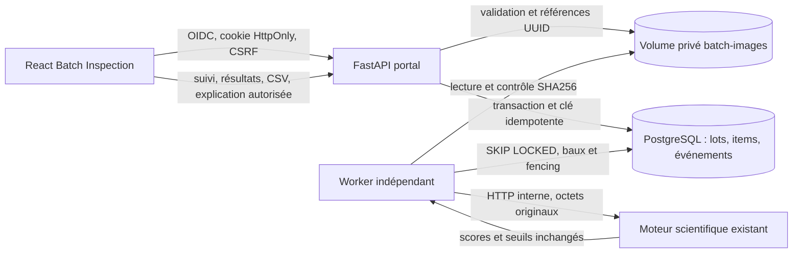

# Industrial Platform V3 — Sprint 2 : Industrial Batch Inspection

Vérification locale du **24 novembre 2026**, branche `feature/industrial-platform`, base Git `f39f46e`. Périmètre : lots privés asynchrones, worker PostgreSQL, interface et validation. Aucun réentraînement, export ONNX, recalibration, commit ou push. Aucun démarrage du Sprint 3, HTTPS public, supervision avancée ou sauvegarde automatique.

## Reprise et préservation

Les huit modules batch et la migration `0f2e340aabb2` existaient à la reprise. La base était encore à `d1c1799c7017`, sans tables batch et avec **11 inspections du Sprint 1**. La migration existante a été complétée puis appliquée ; elle n'a pas été recréée. Elle ajoute uniquement `inspection_batches`, `batch_items` et `batch_events`, leurs contraintes/index et les permissions append-only du journal batch. `alembic check` confirme l'absence d'écart.

Les deux modifications suivies présentes avant le Sprint 2 sont préservées : `deployment/reports/onnx-http.json` garde son SHA256 initial ; le saut de ligne initial et la valeur vide de `tests.environment.PORTAL_DB_PASSWORD` dans le Compose sont conservés. Les trois rapports CI non suivis préexistants restent identiques. La copie initiale et ses empreintes sont dans le dossier ignoré `deployment/industrial/local/sprint2-baseline/`.

`src/`, `backend/app/`, `deployment/validate_portability.py`, `pyproject.toml`, `frontend/DESIGN.md`, le Compose V2, DVC et MLflow restent inchangés. Les 40 empreintes scientifiques, 15 graphes et bindings ONNX, et preuves Windows/Linux ont été vérifiés sans nouveau calcul de parité officielle.

## Architecture livrée



Le worker ne contient ni PyTorch installé, ni copie des modèles, ni secret OIDC/session. Il appelle le backend scientifique privé déjà chargé. Par défaut, **un seul worker d'inférence actif** est admis par verrou consultatif PostgreSQL ; configuration bornée de 1 à 2 slots, avec `--scale worker=2` uniquement si la concurrence est explicitement portée à 2. Les baux existants du portail bornent aussi à deux traitements V3 globaux et un par propriétaire, y compris les inspections individuelles. Une connexion de verrou perdue oblige le worker à s'arrêter avant une nouvelle réservation.

Les lots gardent propriétaire, catégorie/modèle/moteur demandé, UUID de soumission, dates UTC, états et compteurs. Chaque item conserve un UUID interne de fichier, nom nettoyé, SHA256, taille/MIME réel, état, tentatives, bail/token, corrélation scientifique, moteur effectivement utilisé, score/seuil/décision, latence et référence checkpoint/calibration. Les résultats batch restent dans ces nouvelles tables ; aucun item batch n'est ajouté à l'historique individuel du Sprint 1.

La réservation verrouille le lot puis l'item, avec `FOR UPDATE SKIP LOCKED`. Un token UUID distingue chaque réservation ; un ancien token ne peut pas remplacer un résultat plus récent. La finalisation et le recalcul SQL des compteurs sont transactionnels. Le traitement peut être réexécuté après un crash survenu avant son commit : **pas de promesse d'inférence exactement une fois**. Un seul résultat terminal est enregistré par item. Trois tentatives au maximum (initiale + deux reprises), délai de retry initial 5 s, bail 120 s ; seules les erreurs transitoires sont réessayées. Les erreurs de modèle, d'intégrité ou de binding ne déclenchent aucun changement silencieux de moteur.

États : `queued` représente l'attente/pending ; `running`, `retrying`, `completed`, `failed`, `cancelled` pour les items. Le lot peut aussi être `cancelling` ou `completed_with_errors`. `processed` compte les items terminés, erreurs et annulations comprises ; les analyses normales/anormales restent séparées. Une annulation bloque les réservations restantes ; un calcul déjà réservé peut finir, mais son résultat est écarté si l'annulation est demandée avant finalisation.

## API et sécurité

| Route sous `/api` | Fonction et autorisation |
|---|---|
| `GET /batches/limits` | Limites et état du stockage, authentifié |
| `POST /batches` | Import/création multipart `files`, modèle/catégorie/moteur ; permission inspect, origine exacte, CSRF, `Idempotency-Key` UUID |
| `GET /batches` | Historique paginé, propriétaire ou admin |
| `GET /batches/{id}` et `/progress` | Détail/progression réels, même périmètre |
| `GET /batches/{id}/items` | Pagination et filtre `all`, `normal`, `anomaly`, `error` |
| `GET /batches/{id}/errors` et `/events` | Erreurs structurées et traçabilité dans le même périmètre |
| `POST /batches/{id}/cancel` | Annulation autorisée, CSRF, idempotente |
| `GET /batches/{id}/export.csv` | Export contrôlé et audité ; protection contre les formules CSV |
| `GET /batches/{id}/items/{item}/image` | Image privée, autorisation et intégrité ; aucune URL de stockage publique |
| `POST /batches/{id}/items/{item}/explanation` | Calcul réel à la demande, permission inspect/CSRF/quotas ; résultat lié strictement à l'item |

Admin peut consulter les lots ; operator et ai_engineer peuvent créer et traiter leurs propres lots. Auditor reste en lecture seule et ne peut consulter que des lots de son propre périmètre existant, par exemple créés avant un changement de rôle. Il n'existe pas d'organisation ni de partage batch dans ce sprint : aucun accès transversal implicite n'est ajouté. Le changement d'un UUID de lot ou d'item ne contourne pas le contrôle propriétaire ; les ressources hors périmètre renvoient 404. Le masquage React ne remplace pas ces contrôles serveur.

Limites appliquées : **50 fichiers**, **10 MiB/fichier**, **100 MiB/lot**, PNG/JPEG réels uniquement, **20 millions de pixels/image**, aucun ZIP. Les valeurs sont configurables vers le bas dans ce contrat borné. Le validateur Pillow du portail est réutilisé. Le proxy autorise 101 MiB uniquement sur la route de création batch ; le BFF borne le multipart à la limite totale + 1 MiB. Les anciennes routes d'inspection conservent leur limite. Une seule réception/validation multipart par processus borne l'espace temporaire et la mémoire Pillow ; délai de réception 60 s. Création : 3 lots/minute et au plus 3 lots actifs par utilisateur.

Le stockage utilise exclusivement des noms UUID aléatoires, jamais les chemins clients. Dossiers `0700`, fichiers `0600`, création exclusive, refus des symlinks à l'ouverture et fsync fichier/répertoire. Les noms originaux sont des libellés normalisés sans chemin ; les valeurs dangereuses pour un tableur sont préfixées à l'export. Le volume n'est monté ni dans Nginx ni dans V2. Les originaux MVTec ne sont pas déplacés ou modifiés.

## Interface réelle

Nouvel espace **Batch Inspection — Industrial Production Control**, conditionné au build industriel. Import multiple avec drag-and-drop ou sélecteur, vérification locale puis serveur, huit aperçus maximum pour limiter la mémoire, sélection catégorie/modèle/moteur, clé stable de soumission lors d'un retry HTTP. Le suivi interroge les compteurs SQL réels ; aucune progression artificielle.

L'interface affiche historique paginé, états/compteurs séparés, résultats paginés, filtres Normal/Anormal/Erreur, codes d'erreur, SHA256/tentatives, export CSV et annulation confirmée. L'explication est calculée uniquement sur demande, si l'image est encore conservée et le résultat disponible ; aucune heatmap fictive ou base64 persistée. L'auditeur ne voit aucune commande de traitement. L'identité Studio, les tokens et le tableau responsive défilant sont conservés. Desktop 1440 px et mobile 390 px ont été capturés et inspectés localement.

## Résultats réellement exécutés

| Vérification | Résultat |
|---|---|
| Tests portail PostgreSQL isolé | **50 passés**, 21,74 s, dont les 27 du Sprint 1 et 23 contrôles batch |
| Tests React | **81 passés**, 14 fichiers, dont 6 nouveaux contrôles batch |
| Régression scientifique/backend/déploiement/ONNX | **70 passés**, 54,62 s ; fixtures, sans recalcul des preuves officielles |
| Tests de politique CI | **20 passés** |
| TypeScript, ESLint, build frontend | Réussis ; builds industriel Docker et démonstrateur compilé |
| Contrats API et données publiques | Réussis ; aucune modification des agrégats scientifiques |
| Ruff, actionlint, garde Git, `git diff --check` | Réussis |
| Migration additive + `alembic check` | Révision **`0f2e340aabb2`**, aucun écart détecté |
| Initialisation du nouveau volume | Création initiale et seconde exécution validées sur tmpfs isolé et volume conservé |
| Création/idempotence | Vrai upload UI et API : 202 ; replay de même clé : 200, même UUID, aucun nouveau lot |
| Images réellement traitées | **10 images distinctes**, réutilisées dans **5 lots de 10**, soit **50 résultats batch completed** |
| Références individuelles | **40 réponses réelles** du moteur scientifique V2, 10 par couple modèle/moteur |
| Annulation | 1 lot de 10 en attente : **10 cancelled**, sans score inventé |
| Crash/restart worker | **SIGKILL réel**, réservation conservée, reprise après expiration du bail ; un item termine à la tentative 2, événement `item.recovered` |
| RBAC/IDOR réels | 401 sans session ; 404 pour autre propriétaire sur détail/suivi/items/erreurs/événements/CSV/image ; auditor création/annulation 403 ; admin lecture 200 |
| CSRF réel | Mutation sans jeton : **403** |
| Export/interface | CSV de 10 résultats + en-tête, téléchargement navigateur réel, nom traversant nettoyé et formule neutralisée |
| Explication | Réponse réelle B0, score strictement lié à l'item conservé et image explicative visible |
| Reconnexion/persistance | Lots et items retrouvés par nouvelle connexion ; état SQL conservé après arrêt/reprise du worker et renouvellement des conteneurs applicatifs |
| T1/bottle ONNX | Création refusée **503 `onnx_unavailable`**, sans repli |
| Non-régression modèle | **15 PyTorch / 14 ONNX**, sources/poids/seuils/calibrations/preuves inchangés |
| Historique Sprint 1 | **11 inspections intégralement préservées**, comparaison du snapshot SQL avant/après |
| Coexistence | V2:18080 et V3:18180 : **HTTP 200**, backend scientifique et PostgreSQL V3 sans ports publiés |

**221 tests unitaires/régression ont passé**, en plus du scénario navigateur réel. Les fixtures de retry, rétention, quotas et sécurité ne sont pas présentées comme des prédictions scientifiques. Les tests SQL utilisent uniquement `portal_tests` et un répertoire temporaire ; aucune purge de test ne vise `portal` ni le volume d'images réel.

Les 10 sources sont les premières images PNG triées de `bottle/train/good` référencées dans le manifeste de publication existant ; leur SHA256 a été vérifié avant import. Chaque item a été comparé à son image de référence, moteur, score, seuil, décision et SHA256 de modèle. Résultats :

| Lot réel | Images completed | Comparaison individuelle à moteur égal | Écart maximal score | Seuil et décision |
|---|---:|---|---:|---|
| B0 / PyTorch | 10 | 10 réponses réelles | **0 exact** | identiques |
| B0 / ONNX Runtime | 10 | 10 réponses réelles | **0 exact** | identiques |
| T2 / PyTorch | 10 | 10 réponses réelles | **0 exact** | identiques |
| T2 / ONNX Runtime | 10 | 10 réponses réelles | **0 exact** | identiques |
| T2 / PyTorch, crash/reprise | 10 | mêmes 10 références valides réutilisées | **0 exact** | identiques |

Les 50 lignes terminées ne représentent donc pas 50 images distinctes. Un calcul interrompu peut avoir été exécuté côté science sans commit ; les tentatives ne sont pas un compteur certifié d'appels d'inférence. Les preuves de parité antérieures ne sont pas régénérées et aucune tolérance n'est modifiée.

## Confidentialité et rétention

Valeurs provisoires : `BATCH_IMAGE_RETENTION_HOURS=24`, `BATCH_RESULT_RETENTION_DAYS=30`. Les routes privées refusent les images expirées et les résultats expirés même si le worker de purge est indisponible. Les lots expirés ne sont plus listés. Le worker applique la purge des seuls lots terminaux toutes les 60 s environ ; la suppression physique dépend donc de sa disponibilité. Les tâches devenues trop anciennes ne sont plus analysées. Une image en cours ne fait pas l'objet d'une suppression concurrente par la purge.

Après expiration des images, les résultats restent consultables jusqu'à leur propre échéance. Après expiration des résultats, le lot/items/journal détaillé sont supprimés par cascade ; un événement minimal d'audit `batch.results_purged`, corrélé par UUID, subsiste sans score, nom ou image. Les fichiers UUID anciens sans référence, issus d'un upload interrompu, sont également purgés et audités. Aucun autre nom de fichier n'est ciblé. Le code ne supprime jamais `inspections`, utilisateurs, modèles ou fichiers scientifiques du Sprint 1.

La CLI de rétention est **dry-run par défaut**. Les tests ont exercé dry-run, purge d'image à 25 h, purge des résultats à 31 jours, accès expiré sans worker, nettoyage d'orphelin et conservation explicite d'une inspection Sprint 1 de fixture. Ces durées ne constituent pas une politique métier/juridique définitive. Il n'y a ni chiffrement au repos ni dispositif de sauvegarde de production livré dans ce sprint.

## Docker et commandes PowerShell

Depuis la racine, avec la configuration locale existante et les artefacts scientifiques déjà présents. **Ne pas régénérer les comptes ou le realm** au-dessus des volumes conservés.

```powershell
docker compose --env-file deployment/industrial/local/.env -f deployment/industrial/compose.yml build portal web tests
docker compose --env-file deployment/industrial/local/.env -f deployment/industrial/compose.yml up -d portal web worker
docker compose --env-file deployment/industrial/local/.env -f deployment/industrial/compose.yml ps -a
docker compose --env-file deployment/industrial/local/.env -f deployment/industrial/compose.yml run --rm migrate alembic check

# Tests isolés (portal_tests uniquement) :
docker compose --env-file deployment/industrial/local/.env -f deployment/industrial/compose.yml run --rm tests

# Parcours réel : crée des lots de test et interrompt UNIQUEMENT le worker.
# Les réussites déjà enregistrées sont reprises depuis le rapport privé.
node deployment/industrial/batch-qa.mjs

# Audit en lecture seule, avec l'environnement d'outils existant :
.venv-mlops/Scripts/python.exe deployment/industrial/verify-batch-runtime.py
.venv-mlops/Scripts/python.exe deployment/industrial/verify-workspace.py

# Rétention : aperçu seulement, aucune suppression :
docker compose --env-file deployment/industrial/local/.env -f deployment/industrial/compose.yml exec -T worker python -m portal.batch_retention
```

La suppression selon la politique batch peut être déclenchée explicitement avec `python -m portal.batch_retention --execute` dans le worker. Elle ne doit pas être utilisée pour réinitialiser un environnement ; le worker l'applique déjà à ses données batch expirées. Aucun `down -v`, effacement de volume, reset PostgreSQL ou Keycloak n'est nécessaire. Les valeurs configurables sont documentées dans `deployment/industrial/.env.example` et `/api/batches/limits`.

```powershell
Set-Location frontend
npm test -- --maxWorkers=2
npm run typecheck
npm run lint
npm run build
```

Le Compose industriel ajoute `worker`, `batch-storage-init` et le volume **`resilientinspect-industrial_batch-images`**. L'initialiseur non réseau termine puis s'arrête ; le worker et le portail utilisent UID 10002 et rootfs en lecture seule. Son initialisation est idempotente : elle ne refait pas un chmod en root sur un volume déjà privé. Les ports restent 18180 et 18585 en loopback ; SQL, science, portail et worker ne publient aucun port.

V2 a été trouvé arrêté après le redémarrage de Docker survenu avant la reprise. Seuls ses conteneurs existants ont été redémarrés avec `docker start resilientinspect-backend-1 resilientinspect-frontend-1` ; aucune image V2, source, configuration ni volume V2 n'a été reconstruit/modifié. Leur santé et les réponses individuelles ont ensuite été vérifiées.

État final relevé par `verify-batch-runtime.py` : postgres/science/portal/worker/web running et healthy ; Keycloak running (sans healthcheck Compose) ; migration et initialiseur terminés avec code 0. Le volume PostgreSQL et ses données ne sont pas réinitialisés. Le volume privé contient 60 fichiers (50 items terminés et 10 annulés) ; PostgreSQL conserve 6 lots, 51 tentatives et 1 événement de reprise. Les scans des secrets configurés et de chaînes JWT dans les logs renvoient zéro correspondance.

## Fichiers créés/modifiés et preuves

- `services/portal/portal/batch_config.py`, `batch_models.py`, `batch_storage.py`, `batch_storage_init.py`, `batch_science.py`, `batch_queue.py`, `batch_worker.py`, `batch_retention.py`, `batch_api.py`.
- `services/portal/migrations/versions/0f2e340aabb2_batch_inspection.py` existant complété ; `migrations/env.py` enregistre les nouveaux modèles.
- `services/portal/portal/app.py` raccorde le router et la limite multipart dédiée ; `tests/conftest.py`, `tests/test_batches.py`.
- `frontend/src/portal/BatchInspection.tsx`, `batch.ts`, `batch.css`, `BatchInspection.test.tsx`, `batch.test.ts`, et raccordement conditionnel dans `frontend/src/App.tsx`.
- `frontend/nginx.portal.conf`, `deployment/industrial/compose.yml`, `.env.example`.
- `deployment/industrial/batch-qa.mjs`, `verify-batch-runtime.py`, `docs/industrial/sprint2-verification.md`.

Les rapports `batch-browser-verification*.json`, `batch-qa-state.json` (références réelles réutilisables), `batch-runtime-verification.json`, captures et baselines sont dans **`deployment/industrial/local/` ignoré**. Ils ne contiennent pas de secrets OIDC/session ; les identifiants restent dans les fichiers de développement privés existants. Aucun fichier image original, base64, checkpoint, ONNX, volume ou secret n'est proposé à publication. La garde dépôt et les vérifications SHA256 passent.

## Limites restantes et décision

Le Sprint 2 est limité à la validation locale. Le scénario réel porte sur 10 images bottle et B0/T2 avec les deux moteurs ; il ne prouve pas une capacité de production à grande échelle. Les essais d'erreurs transitoires persistantes et de rétention utilisent des fixtures isolées. L'annulation ne stoppe pas un calcul natif déjà parti ; la reprise après crash peut répéter un calcul mais protège la finalisation par fencing/idempotence. Les 120 s de bail expliquent le délai de récupération observé.

Le périmètre batch est propriétaire/admin, sans organisations ni partage batch supplémentaire. Rétention physique suspendue quand le worker est arrêté ; refus d'accès à échéance toujours côté API. Les valeurs de conservation et les quotas restent à valider selon la politique finale. Les risques de production du Sprint 1 restent applicables : HTTP/Keycloak start-dev/H2, TLS/secrets/MFA de production, audit/verrouillage des dépendances, sauvegarde/restauration, charge et surveillance à traiter dans les phases autorisées suivantes. Aucune exposition Internet ni phase suivante n'a été démarrée.
