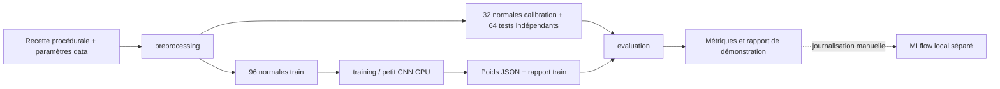

# Pipeline DVC de développement

Pipeline exécutable **prétraitement → entraînement → évaluation**, isolé des
quinze modèles PyTorch et quatorze ONNX officiels. Les trois étapes sont dans le
`dvc.yaml` de la racine, les paramètres dans `params.yaml`, les empreintes et
valeurs utilisées dans `dvc.lock`.

L’implémentation de cette mission est dans le worktree
`C:\Users\nouhe\resilientinspect-dvc`, branche `feature/mlops-dvc-pipeline`.
Le worktree principal et son état non commité sont conservés.



## Prérequis et commandes PowerShell

Python 3.11.9 ; versions vérifiées avant chaque étape : PyTorch 2.15.0+cpu,
NumPy 2.3.5, PyYAML 6.0.3, DVC 3.67.1 et MLflow 3.16.1. Le protocole est CPU,
une thread par défaut. Aucune dépendance scientifique existante n’a été installée,
mise à jour ou réécrite pendant la mission.

Commandes réellement utilisées avec l’interpréteur existant en lecture seule :

```powershell
Set-Location C:/Users/nouhe/resilientinspect-dvc
$demoPython = 'C:/Users/nouhe/resilientinspect-ai/.venv-mlops/Scripts/python.exe'
./mlops/dvc_pipeline/run.ps1 -Python $demoPython -Action dag
./mlops/dvc_pipeline/run.ps1 -Python $demoPython -Action repro
./mlops/dvc_pipeline/run.ps1 -Python $demoPython -Action metrics
```

Ces chemins sont une configuration locale explicite ; aucun chemin absolu
n’apparaît dans `dvc.yaml` ou `params.yaml`. Le wrapper place temporairement
l’interpréteur choisi dans PATH pour que les commandes `python -m ...` des étapes
utilisent le même environnement, et isole le cache de métadonnées DVC du worktree.
Il restaure les variables modifiées à sa sortie.

Pour un nouvel environnement **distinct**, sans toucher à une `.venv` scientifique :

```powershell
# Exécuter seulement si cette .venv-mlops n’existe pas déjà dans CE worktree.
py -3.11 -m venv .venv-mlops
.venv-mlops/Scripts/python.exe -m pip install -r mlops/dvc_pipeline/requirements.txt
$demoPython = (Resolve-Path .venv-mlops/Scripts/python.exe).Path
./mlops/dvc_pipeline/run.ps1 -Python $demoPython -Action repro
```

Le fichier de dépendances réutilise les contraintes résolues
`mlops/requirements-lock.txt`. La version Python doit être exactement 3.11.9 ;
un autre Python 3.11 est refusé par le contrôle d’environnement. Ne jamais
réinstaller ces paquets dans l’environnement servant l’inférence.

Dans un shell où ce Python est déjà activé :

```powershell
python -m dvc dag
python -m dvc repro
python -m dvc metrics show mlops/dvc_pipeline/work/evaluation/metrics.json
python -m dvc status dvc.yaml
```

`dvc dag` montre également les deux pointeurs de livraison indépendants.
`dvc dag dvc.yaml` limite l’affichage aux trois étapes. L’arête directe entre
prétraitement et évaluation représente les tableaux de calibration/test,
qui ne sont pas des sorties d’entraînement.

## Données, entraînement et évaluation

Le worktree dédié ne contenait ni `mlops/dataset`, ni `mlops/deployment`, ni
configuration de remote local. Le pipeline génère donc un jeu de développement
procédural autorisé, décrit par `recipe.json`, sans lire MVTec ni télécharger
les artefacts officiels. Aucune commande de récupération des deux pointeurs
existants n’est nécessaire.

Prétraitement : textures grises à bandes, pixels quantifiés puis normalisés en
float32 `[N,1,32,32]`, seeds distinctes par split, anomalies synthétiques par carré
clair dans le seul test. Le manifeste contient les identifiants locaux,
affectations et SHA256 de chaque échantillon/tableau. Les contrôles vérifient
les valeurs finies, la plage, les effectifs et l’absence de doublons de contenu
entre les splits. Valeurs par défaut : 96 normales train, 32 normales calibration,
32 normales et 32 anomalies de test ; soit **192 images**.

Entraînement : petit autoencodeur convolutionnel `tiny_procedural_ae_v1`, Adam,
MSE, six époques, batches de seize, seed 42. Il part d’une initialisation aléatoire
fixée et effectue réellement **36 mises à jour**. Les poids changent ; la loss
est mesurée avant et après. Aucun checkpoint ancien n’est copié ni chargé.
Les architectures officielles de `src/models/` imposent notamment la géométrie
256×256 et leurs protocoles ; ce petit réseau 32×32 est volontairement distinct.
Les modules scientifiques ont été examinés et restent inchangés. Le pipeline
reprend les pratiques de seed, de séparation des splits et de contrôle SHA256,
et réutilise les bibliothèques CPU déjà installées, sans appeler les trainers
officiels avec leurs répertoires par défaut.

Évaluation : rechargement et vérification des poids JSON du modèle de démo ;
seuil fixé au quantile 0,95 des erreurs de reconstruction sur les normales de
calibration. Seulement ensuite, calcul des scores du test indépendant et des
métriques à partir de ses labels synthétiques connus. La dernière époque est
utilisée ; aucun choix de modèle ou de quantile n’est optimisé sur ces tests.
Le manifeste est partagé comme métadonnée de provenance ; les tableaux de test
ne sont ni chargés ni évalués par l’étape training.

Résultats constatés : loss initiale **0,0187973**, finale **0,00439202** ;
accuracy de démo **0,90625**, AUROC **1,0**, F1 **0,914286** sur 64 tests.
La matrice comprend 32 vrais positifs, 26 vrais négatifs, six faux positifs,
zéro faux négatif. Ces chiffres décrivent uniquement ce jeu procédural simple ;
ils ne mesurent pas la performance MVTec et ne remplacent aucune métrique officielle.

## Paramètres, sorties et cache

| Section | Paramètres réellement consommés | Étapes invalidées |
|---|---|---|
| `data` | seed, taille et quatre effectifs | preprocessing, puis dépendants si leurs entrées changent |
| `training` | seed, epochs, batch_size, learning_rate, channels, cpu_threads | training et evaluation si les poids changent |
| `evaluation` | normal_quantile | evaluation seulement |

Les paramètres sont validés et bornés : tailles multiples de quatre, effectifs
de développement limités, CPU limité et valeurs finies. Les dépendances locales
des modules et la spécification d’environnement sont déclarées explicitement.
Un changement de code du modèle invalide training/evaluation.

| Sortie privée, sous `mlops/dvc_pipeline/work/` | Contenu |
|---|---|
| `prepared/` | quatre tableaux NumPy, manifeste et contrôles qualité |
| `trained/` | poids JSON déterministes et historique/paramètres d’entraînement |
| `evaluation/report.json` | provenance, seuil de démo, scores et labels de test |
| `evaluation/metrics.json` | métriques DVC numériques, préfixées `demo_` pour les performances |

Ces dix fichiers sont cachés par DVC et ignorés par Git via le `.gitignore` du
module. Les métriques utilisent aussi `cache: true`, pour ne pas publier de
résultats bruts de développement. Les SHA256 permettent une vérification forte ;
les MD5 de DVC assurent l’adressage du cache. Les poids JSON contiennent des
tensors float32 avec leurs formes, sans pickle ni chargement de checkpoint officiel.

Le cache réel est celui du worktree, `.dvc/cache`, en mode **copy**, comme la
configuration publique existante. Les sorties ne chevauchent jamais
`mlops/dataset/` ou `mlops/deployment/`. Les deux `.dvc` existants et `.dvc/config`
ne sont pas modifiés. La reproduction vise le nouveau `dvc.yaml`, sans `pull`,
`checkout`, `gc`, `push` ou réécriture des pointeurs officiels.

Les durées, UUID et informations Git varient à chaque exécution. Ils sont donc
consignés séparément dans `mlops/local/dvc_pipeline/executions.jsonl`, hors des
sorties cachées, puis tracés dans MLflow. Les poids, manifestes, loss par époque
et métriques restent déterministes. Le commit parent est accompagné du marqueur
`dirty=true` : aucun commit de cette mission n’a été créé. Les dépendances et
paramètres exacts non commités sont identifiés dans `dvc.lock`.

## Preuves de reproductibilité

```powershell
./mlops/dvc_pipeline/run.ps1 -Python $demoPython -Action verify
./mlops/dvc_pipeline/run.ps1 -Python $demoPython -Action tests
./mlops/dvc_pipeline/run.ps1 -Python $demoPython -Action regression
```

`verify` effectue réellement :

1. DAG puis reproduction forcée avec `--no-run-cache` : trois étapes exécutées.
2. Reproduction sans changement : zéro étape, sorties et dates de modification
   identiques.
3. Seed d’entraînement 42→43 : training/evaluation, prétraitement conservé.
4. Quantile 0,95→0,90 : evaluation seule, poids conservés.
5. Restauration des paramètres : retour aux résultats cachés d’origine.
6. Modification temporaire du fichier du modèle : training/evaluation uniquement.
7. Restauration du code puis autre exécution forcée sans cache d’exécution :
   les dix SHA256 de sorties sont identiques à la première exécution indépendante.
8. Dernière reproduction : zéro étape ; `dvc status dvc.yaml --json` vaut `{}`.

Les paramètres et le code temporairement testés sont restaurés dans un `finally`.
Les logs, reçus d’exécution et preuves sont dans `mlops/local/dvc_pipeline/`, ignoré
par Git. Ne pas exécuter ces tests pendant une modification manuelle simultanée
de `params.yaml` ou `model.py`.

La suite dédiée compte neuf tests réussis. Les suites existantes backend,
portabilité, Compose, intégrité MLOps et politique CI comptent **86 réussites**.
Le lanceur `regression.py` lie explicitement le package scientifique au worktree
testé ; il ne modifie pas l’installation editable partagée. Cela évite de mélanger
les empreintes de sources de deux worktrees différents.

## MLflow séparé et facultatif

```powershell
./mlops/dvc_pipeline/run.ps1 -Python $demoPython -Action track
```

Une expérience `ResilientInspect-DVC-Pipeline-Demo` est créée dans une **nouvelle
base locale** `mlops/local/dvc_pipeline/mlflow/tracking.db`. Sont tracés : seeds,
configuration, SHA du manifeste, identité Git, loss, métriques, durées et artefacts
de démonstration. La commande refuse un pipeline non à jour et réutilise le run
terminé pour la même empreinte. Deux appels réels ont conservé un seul run.
La base consolidée des 30 runs et les trois modèles du Registry ne sont jamais
ouverts en écriture. Aucun modèle de démonstration n’est enregistré ou promu.

L’interface MLflow existante ne liste pas automatiquement cette base séparée.
Pour la consulter, ouvrir une interface locale distincte sur un port libre,
explicitement choisi, par exemple :

```powershell
$demoDb = (Join-Path (Get-Location).Path 'mlops/local/dvc_pipeline/mlflow/tracking.db').Replace('\','/')
& $demoPython -m mlflow server --backend-store-uri "sqlite:///$demoDb" --host 127.0.0.1 --port 15000
```

Ce serveur facultatif n’a pas été démarré pendant la mission ; la journalisation
MLflow a été vérifiée directement dans le stockage local.

## Prefect : aucun entraînement planifié

Les flows existants restent en lecture seule et conservent les intervalles
3 600 s et 60 s. Le nouveau point d’entrée facultatif est **désactivé par défaut** :

```powershell
python -m mlops.dvc_pipeline.prefect_flow
# Renvoie disabled ; aucun sous-processus ni import Prefect.
```

Activation manuelle explicite, depuis un interpréteur avec Prefect 3.9.5 :

```powershell
& C:/Users/nouhe/resilientinspect-ai/.venv-prefect/Scripts/python.exe `
  -m mlops.dvc_pipeline.prefect_flow --enabled --python $demoPython
```

Ce flow ne crée aucun déploiement ni planning. Il délègue à `dvc repro` avec
concurrence manuelle et délais bornés, sans retry d’entraînement. L’intégration
a réellement terminé en `Completed` sur les sorties déjà à jour ; aucun
entraînement supplémentaire n’a été déclenché par cet essai. Un appel manuel
après modification des paramètres peut, lui, entraîner le modèle de développement.

## Limites et démonstration en deux minutes

La preuve d’identité binaire concerne les mêmes versions, le même matériel CPU
et ce Windows. L’identité bit à bit entre Linux/Windows, autres processeurs ou
autres versions n’est pas revendiquée. Le jeu procédural ne valide pas les modèles
industriels. Aucun remote n’est nécessaire/configuré dans le worktree ; le cache
local ne constitue pas une sauvegarde hors machine. Les fichiers du pipeline
restent non commités à la demande de l’utilisateur. Aucune CI distante n’a été lancée.

Scénario pour Mme Sonia Gharsalli :

1. **0:00–0:20** : afficher `dvc dag dvc.yaml`, `params.yaml`, la séparation des
   trois étapes et des deux pointeurs officiels.
2. **0:20–1:10** : exécuter une vraie reproduction forcée, puis montrer les
   36 mises à jour, la diminution de loss et les métriques de développement.
3. **1:10–1:30** : relancer `dvc repro` sans changement et montrer les étapes
   ignorées, puis le `dvc.lock` qui lie paramètres, dépendances et artefacts.
4. **1:30–2:00** : montrer la preuve de seed/quantile et les dix SHA256 identiques
   dans le rapport, le run MLflow séparé et les SHA officiels inchangés.

```powershell
# PATH de l’environnement CPU activé, ou utiliser $demoPython et -m dvc :
& $demoPython -m dvc dag dvc.yaml
./mlops/dvc_pipeline/run.ps1 -Python $demoPython -Action recompute
./mlops/dvc_pipeline/run.ps1 -Python $demoPython -Action repro
```

Voir les résultats complets dans
[`dvc_pipeline_verification.md`](../../reports/experiments/dvc_pipeline_verification.md).
Références : [commandes de reproduction DVC](https://doc.dvc.org/command-reference/repro),
[structure des pipelines et caches](https://doc.dvc.org/user-guide/project-structure).
