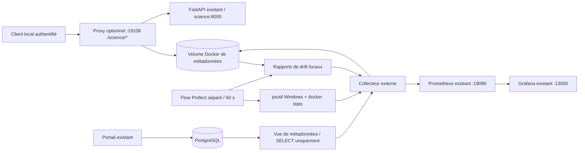

# Monitoring MLOps local

Ce module ajoute la surveillance aux services industriels existants. Il réutilise
Prometheus et Grafana de `deployment/operations/`, leurs secrets et leurs volumes.
Le backend scientifique, React, les checkpoints, calibrations et preuves de parité
restent inchangés. Aucun entraînement ni téléchargement d’image industrielle.



## Démarrage Windows

Prérequis : stack `resilientinspect-industrial`, stack
`resilientinspect-observability`, image locale `resilientinspect-portal:local`,
environnement `.venv-prefect` et serveur Prefect :4200 déjà disponibles.
Le module ne démarre pas les stacks préexistantes et ne change pas leurs accès.

Depuis la racine du dépôt :

```powershell
./mlops/monitoring/bootstrap.ps1
# Dans un terminal conservé ouvert :
.venv-prefect/Scripts/python.exe -m mlops.monitoring.flow --serve
```

Le bootstrap crée un environnement Python isolé avec un verrou de dépendances,
une vue PostgreSQL et un rôle en lecture seule, les secrets locaux, une référence
figée, puis uniquement les conteneurs propres au monitoring. Il ajoute un job et
un groupe de règles aux fichiers Prometheus existants, les valide avec promtool,
et recharge Prometheus par SIGHUP. Grafana recharge son provisioning via son API
administrateur authentifiée. Aucun redémarrage des services existants.

Le mot de passe initial enregistré dans `deployment/industrial/local/observability/secrets/`
peut différer du mot de passe actuel en base Grafana. Dans ce cas, enregistrer le
mot de passe actuel dans `mlops/local/monitoring/secrets/grafana_password`.
Le programme ne réinitialise aucun accès et ne révèle aucune valeur.
Une erreur Grafana fait échouer `connect` explicitement ; corriger l’accès puis relancer.

Ports constatés pendant cette mission :

| Service | Accès | État / périmètre |
|---|---|---|
| Application industrielle React | http://127.0.0.1:18180 | Préexistante, conservée |
| FastAPI scientifique | `science:8000`, réseau Docker privé | 15 PyTorch / 14 ONNX |
| Prometheus | http://127.0.0.1:19090 | Existant, authentifié |
| Grafana | http://127.0.0.1:13000 | Existant, authentifié |
| Collecteur et proxy optionnel | http://127.0.0.1:19108 | Nouveau, bearer requis sauf `/health` |
| Prefect | http://127.0.0.1:4200 | Existant, serveur local |
| Ancienne stack / MLflow | 18080 / 8001 / 5000 | Non disponibles au constat initial ; non démarrés par cette mission |
| Oracle | 8080 | Aucune intervention |

## Couverture des mesures

Les métriques HTTP existantes du portail (`ri_http_*`) restent collectées. Le
proxy optionnel expose `ri_mon_http_requests_total{route,method,status_class}` et
un histogramme de durée. Ses seules routes sont `/science/health`,
`/science/model/metadata`, `/science/predict` et `/science/predict/visualize`.
Le bearer est le secret métrique existant, jamais transmis au backend.
Les réponses scientifiques et le refus ONNX T1/bottle sont conservés.

Le trafic direct vers FastAPI ne passe pas automatiquement par ce proxy.
Les compteurs du proxy ne prétendent donc pas mesurer tout le trafic interne.
Les prédictions réussies du portail, y compris les batches, sont surveillées via
la vue SQL sans changer le routage existant. Les requêtes par moteur sont connues
pour les prédictions réussies ; les erreurs ne sont pas attribuées à un moteur.
Les histogrammes HTTP mesurent des requêtes réelles, y compris les appels de
validation. La séparation des origines ci-dessous concerne les prédictions.

Les quantiles HTTP sont des estimations par buckets, affichées par endpoint
seulement à partir de 20 observations pour p50, 40 pour p95 et 100 pour p99 sur
cinq minutes. Une case vide signifie absence de données suffisantes. Les erreurs
5xx sont divisées par le nombre réel d’appels observés dans la même fenêtre.
Les compteurs HTTP repartent à zéro après redémarrage ; Prometheus gère ces resets.
Les statistiques de prédiction sont des gauges sur une fenêtre, jamais des
compteurs cumulés déguisés ni des séries auxquelles appliquer `rate()`.

`psutil` mesure CPU/RAM de Windows. `docker stats --no-stream` mesure CPU/mémoire
des conteneurs ResilientInspect ; un cœur Docker occupé représente 100 %, donc
plusieurs cœurs peuvent dépasser 100 %. Le conteneur d’initialisation du volume
est normalement arrêté après réussite. Aucun socket Docker n’est monté.
Les valeurs trop anciennes disparaissent ; les métriques de fraîcheur restent
visibles. Une mesure absente n’est jamais remplacée par une fausse valeur CPU/RAM.

## Confidentialité et persistance

Le rôle `ri_mlops_monitor` lit uniquement
`mlops_monitoring.prediction_metadata`. Il ne peut lire ni `users` ni
`inspections`, ni modifier les batches. La vue exclut utilisateurs, fichiers,
images, empreintes d’image, sessions, tokens et erreurs libres. Le client SQL
est en lecture seule, avec délais de connexion/requête bornés.

La base dédiée conserve uniquement : clé HMAC de déduplication, horodatage,
modèle, catégorie, SHA de version, moteur, origine, score, seuil scientifique,
décision et durée d’inférence. Le UUID brut n’est pas conservé. Le proxy manipule
les images uniquement en mémoire pendant leur transmission locale ; il ne les
écrit pas, ne les journalise pas et ne les envoie à aucun service externe.

Les quatre origines ne sont jamais mélangées dans les statistiques :

- `production` : trafic de service après activation, sans annotation explicite ;
  il ne constitue pas une vérité terrain.
- `historical` : résultats SQL antérieurs à l’activation, origine expérimentale
  inconnue ; ils ne sont pas présentés comme une production démontrée.
- `validation` : appels locaux explicitement identifiés pour la vérification.
- `synthetic` : fixtures de démonstration isolées, jamais présentées comme mesures
  réelles de l’infrastructure ou comme prédictions scientifiques officielles.

L’origine explicite du proxy prévaut sur une éventuelle relecture du même UUID
par SQL. La déduplication est persistante. Le volume
`resilientinspect-mlops-monitoring_metadata` contient SQLite exclusivement sous
Linux : ne pas ouvrir cette base depuis Windows. Son répertoire est en mode 0700,
la base en 0600, propriétaire de l’utilisateur non privilégié `portal`.
Le service d’initialisation ne conserve que la capacité CHOWN, sans réseau.
Le collecteur n’a aucune capacité Linux et son image est en lecture seule.

Rétention des métadonnées : sept jours, purge toutes les dix secondes,
`secure_delete` et checkpoint WAL après purge. Fenêtre de statistiques/drift :
24 heures. La collecte SQL est plafonnée à 10 000 résultats sur sept jours ;
un dépassement déclenche une alerte de contrôle et invalide l’interprétation
comme couverture exhaustive. Cette configuration est dimensionnée pour une
démonstration locale, pas pour un flux industriel à grande échelle.

Les secrets et rapports d’exécution restent sous `mlops/local/monitoring/`, ignoré
par Git. Les ACL Windows restreignent les répertoires runtime/secrets à l’utilisateur
courant, SYSTEM et Administrateurs. Les preuves agrégées de vérification sont
conservées pour l’audit ; elles ne contiennent aucune image ni identité.
Prometheus conserve ses séries sept jours dans son volume existant ; Grafana
conserve son volume et sa source de données authentifiée `ri-prom`.

## Drift : référence, méthode et limites

`reference.py` extrait les scores normaux des preuves de parité Windows archivées.
Il vérifie leurs SHA256, celui des métadonnées et du manifeste, et l’appartenance
de chaque exemple au split `val` figé. Aucun exemple officiel de test n’est lu
pour définir la référence ou choisir les seuils de drift. La référence privée
est ensuite figée avec son propre SHA256 ; elle n’est pas recalculée sur le trafic.
Elle contient 29 groupes séparés : 15 PyTorch, 14 ONNX. L’ONNX T1/bottle refusé
n’a aucune référence admise. Les 15 références PyTorch utilisent leur score
PyTorch archivé, y compris T1/bottle dont le candidat ONNX a échoué.

L’alternative statistique à Evidently est volontaire : calcul ECDF de la distance
KS à deux échantillons, plus différence absolue de taux de décisions anormales,
en bibliothèque standard. Cela évite de changer les dépendances scientifiques
ou d’ajouter une bibliothèque lourde au service existant. Les égalités sont
prises en compte. Il s’agit de tailles d’effet opérationnelles, sans p-value
ni garantie de significativité. Voir la définition de la statistique dans
[SciPy](https://docs.scipy.org/doc/scipy/reference/generated/scipy.stats.ks_2samp.html).

Chaque comparaison est isolée par modèle, catégorie, SHA de version, moteur et
origine. Au moins 30 scores de référence et 30 scores courants sont requis.
Les états `missing_reference`, `insufficient_data` et `invalid_data` sont explicites.
Valeurs non finies, hors limites, décisions incohérentes, versions inconnues et
seuils non concordants sont rejetés ou signalés. Un nouveau modèle/version exige
une nouvelle référence auditée ; il n’est pas automatiquement comparé à une autre
version. Les rejets et la troncature sont des métriques de contrôle alertables.

Politique initiale : distance KS > 0,30 ou écart de taux d’anomalies > 0,20.
Ce sont des seuils de monitoring configurables dans `config.json`, pas les seuils
scientifiques et pas un réglage optimisé sur le test officiel. Le seuil de décision
de chaque groupe reste celui de sa calibration figée. Une dérive face à une
référence normale peut refléter un changement du mélange de produits/défauts ;
elle ne démontre ni une baisse d’accuracy ni un défaut du modèle.
Ne pas agréger les scores de modèles/catégories différents.

Sans caractéristiques d’image collectées, le drift des entrées est déclaré
indisponible. Sans vérité terrain, aucun accuracy/AUROC/F1 de production n’est
calculé. Les rapports JSON/HTML sont dans `mlops/local/monitoring/runtime/drift.*`.

## Dashboards, alertes et Prefect

Les trois définitions JSON de `dashboards/` sont copiées dans le provider de
fichiers déjà monté de Grafana, sous le dossier **Industrial Operations** :

- [Infrastructure](http://127.0.0.1:13000/d/ri-mlops-infrastructure) : Windows,
  conteneurs, disponibilité, fraîcheur et alertes.
- [API Performance](http://127.0.0.1:13000/d/ri-mlops-api) : débit, classes HTTP,
  erreurs, durées, quantiles conditionnels et modèles prêts.
- [Model Monitoring](http://127.0.0.1:13000/d/ri-mlops-models?var-source=validation) :
  observations, distributions, décisions, latences et drift ; choisir l’origine.

Dix règles Prometheus ajoutées : indisponibilité science/scrape, erreurs > 5 %,
p95 > 5 s, CPU/RAM > 90 %, modèles prêts < 15/14, drift KS, drift du taux
d’anomalies et contrôle du monitoring périmé/invalide. Persistance requise : 20 s.
Fraîcheur maximale : 180 s. Configuration : `config.json`, puis relancer `connect`
et redémarrer uniquement le collecteur pour recharger les paramètres Python.
Les règles sont affichées par la métrique `ALERTS` dans Grafana et via
l’[interface Prometheus](http://127.0.0.1:19090/alerts).
Aucun Alertmanager ou destinataire externe n’est configuré.

Le flow `resilientinspect-monitoring-drift/local-monitoring` est distinct du flow
scientifique existant. Il collecte les mesures système puis produit le drift
toutes les 60 secondes, un run à la fois, fuseau Africa/Lagos, une reprise sur
erreur et des sous-processus bornés. Il ne charge pas les poids et ne réentraîne
rien. Son runner doit rester actif ; sa fermeture met sa planification en pause.
La fraîcheur des fichiers détecte les interruptions. Les échecs de mise au point
restent visibles dans l’historique Prefect ; les runs réussis ultérieurs sont
la preuve du fonctionnement final, pas une suppression des échecs.

## Tests et démonstration en 2–3 minutes

```powershell
.venv-monitoring/Scripts/python.exe -m pytest mlops/monitoring/tests -q
.venv-monitoring/Scripts/python.exe -m mlops.monitoring.verify_runtime rules
.venv-monitoring/Scripts/python.exe -m mlops.monitoring.verify_runtime inference
.venv-monitoring/Scripts/python.exe -m mlops.monitoring.verify_runtime alerts
node mlops/monitoring/browser-qa.mjs
.venv-monitoring/Scripts/python.exe -m mlops.monitoring.verify_preservation privileges
.venv-monitoring/Scripts/python.exe -m mlops.monitoring.verify_preservation persistence
.venv-prefect/Scripts/python.exe -m mlops.monitoring.verify_preservation preservation
```

Le dernier contrôle nécessite le constat initial privé `mlops/local/monitoring/baseline.json`
enregistré avant les modifications de cette mission. Ne pas le remplacer par un
constat après intervention. Les vérifications d’inférence utilisent uniquement
des images normales du split de validation et les transmettent au service local.
Le test de persistance redémarre uniquement le nouveau collecteur.

Scénario devant Mme Sonia Gharsalli :

1. **0:00–0:40** : montrer les trois cibles `up` dans Prometheus, puis Infrastructure
   et API Performance ; les données sont réelles. Afficher les 15/14 modèles prêts.
2. **0:40–1:10** : ouvrir Model Monitoring avec `source=validation` et le rapport
   HTML local : 30 prédictions PyTorch B0/bottle, référence de 42 normales,
   comparaison stable ; le groupe ONNX à un exemple reste insuffisant.
3. **1:10–2:10** : lancer la commande suivante. Les dix règles passent en alerte
   sur des séries explicitement `source=synthetic`, dont une vraie comparaison
   statistique de scores synthétiques décalés contre la référence figée.
4. **2:10–2:40** : le script résout automatiquement les fixtures, vérifie la
   disparition des dix alertes synthétiques et conserve la preuve JSON. Les
   alertes réelles éventuelles restent visibles. Montrer le run Prefect réussi.

```powershell
.venv-monitoring/Scripts/python.exe -m mlops.monitoring.verify_runtime alerts
```

Contrôle manuel alternatif :

```powershell
docker exec resilientinspect-mlops-monitoring-collector-1 python -m mlops.monitoring.demo stable
docker exec resilientinspect-mlops-monitoring-collector-1 python -m mlops.monitoring.demo alerts
# Observer Prometheus/Grafana pendant environ 40 secondes, puis :
docker exec resilientinspect-mlops-monitoring-collector-1 python -m mlops.monitoring.demo resolve
```

Les fixtures d’alerte expirent après 150 secondes ; leurs lignes dédiées sont
alors exclues automatiquement. La résolution explicite les efface immédiatement.
Les démonstrations `stable`/`shift` isolées persistent jusqu’à `resolve` ou la purge
de rétention ; ne pas les confondre avec la production.

## Arrêt et retrait

Arrêter le runner de monitoring avec Ctrl+C, puis :

```powershell
docker compose -f mlops/monitoring/compose.yml stop collector
```

Les métadonnées persistent. Ne pas utiliser `down -v` pour un arrêt ordinaire.
Pour retirer complètement l’intégration, supprimer seulement les blocs commençant
par `# BEGIN MLOPS MONITORING` dans les deux fichiers Prometheus et les trois
fichiers `deployment/operations/dashboards/ri-mlops-*.json`, valider puis recharger
Prometheus/Grafana comme dans `configure.py`. Ne pas restaurer aveuglément les
copies `.before` si d’autres changements sont survenus. La vue et le rôle sont
isolés ; leur retrait doit être une opération de nettoyage explicitement choisie.

Références : [rechargement Prometheus par SIGHUP](https://prometheus.io/docs/prometheus/latest/configuration/configuration/),
[quantiles par histogrammes](https://prometheus.io/docs/practices/histograms/).
Les résultats réels, versions et limites de cette exécution figurent dans
[`monitoring_verification.md`](../../reports/experiments/monitoring_verification.md).
