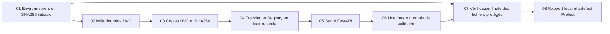

# Prefect — orchestration MLOps non destructive

Implémentation et vérification du **27 novembre 2026**, branche dédiée existante `feature/mlops-prefect-orchestration`. Prefect **3.9.5**, Python **3.11.9**, environnement isolé `.venv-prefect`. Aucun entraînement, recalibrage, réexport ONNX ou import de métriques officielles n’est lancé.

Dashboard local : **http://127.0.0.1:4200**. L’application industrielle reste sur **http://localhost:18180**. Le serveur Prefect utilise sa propre SQLite sous `mlops/local/prefect/`, pas PostgreSQL industriel. Aucun Compose existant n’est modifié.

## Analyse et choix

Le README, `mlops/`, les modules data/training/evaluation, FastAPI, les déploiements, configurations et workflows GitHub ont été examinés. Aucun ancien flow Prefect n’était présent ; seul le venv vide existait. Les fonctions d’entraînement et d’évaluation complète produisent des artefacts scientifiques et ne sont pas appelées.

Les adaptateurs réutilisent `scripts/ci/check_dvc_metadata.py`, `mlops/dvc_release.verify`, `mlops/common.records`, les chargeurs `load_reference`/`examples` et `backend.app.inference.predict`. Les scripts `mlops/verify.py`, `registry.verify` et `registry.binding` ne sont pas exécutés tels quels : ils écrivent respectivement des tags, rapports/alias ou fichiers de binding. Le nouveau contrôle Registry ouvre uniquement les bases et paquets existants en lecture seule.

Le runner local [`serve()`](https://www.prefect.io/docs/v3/how-to-guides/deployment_infra/run-flows-in-local-processes) fournit les déploiements et la planification sans worker Docker, Redis, Kubernetes ou Prefect Cloud. La [documentation des task runners](https://www.prefect.io/docs/v3/concepts/task-runners) décrit les dépendances entre futures utilisées ici. Le serveur et le runner doivent rester démarrés pour exécuter les échéances.

## Architecture et dépendances explicites



Les arcs opérationnels sont des `wait_for=[future]` explicites. Le terminal est résolu par `.result()` ; une tâche bloquée par un échec amont ne peut pas faire réussir le flow. Le garde final et le rapport sont également tentés après un échec.

1. **Environnement :** validation des paramètres et interpréteurs, empreintes des fichiers canoniques du manifeste, sources protégées, configurations, preuves Windows/Linux et base Tracking.
2. **Métadonnées DVC :** vérificateur existant, couverture et chemins sûrs des pointeurs.
3. **Disponibilité DVC :** contrôle SHA256 des **1 898 fichiers / 1 907 306 922 octets** des copies de livraison, puis `dvc status --json`. `--remote-status` ajoute le contrôle du remote existant ; aucun `pull`, `push`, `checkout` ou `stage` automatique.
4. **MLflow/Registry :** SQLite `mode=ro` et `query_only`, fidélité des historiques originaux, des métriques et des liens poids/calibrations des quinze modèles. Vérification des trois alias/version Registry, des fingerprints et des SHA256 des artefacts réellement conditionnés. Aucun client susceptible de migrer la base, aucun tag/alias écrit.
5. **FastAPI :** santé du service scientifique industriel par `docker exec` et GET interne `/health`, sans publication de port ni modification de Keycloak. Couverture attendue : **15 PyTorch / 14 ONNX**, aucun repli T1/bottle.
6. **Évaluation légère :** une image normale issue du split de validation, dont la source originale est `train/good`, via le prétraitement et l’inférence T2/bottle existants. Poids et seuil figés. Aucune lecture du test par cette étape, aucune métrique officielle calculée ou écrite.
7. **Préservation :** les **1 944 fichiers protégés** de cette installation sont rehashés et doivent rester identiques.
8. **Rapport :** JSON par UUID/tentative dans `mlops/local/orchestration/runs/`, plus un artefact Markdown dans Prefect. Un défaut de reporting produit aussi un état Failed, jamais un rapport Completed trompeur.

L’option `--evaluation auto` signale explicitement `skipped` si les dépendances ou les données manquent ; la tâche de vérification peut alors être Completed, mais le rapport ne prétend pas qu’une inférence a eu lieu. `--evaluation required` échoue dans ce cas. Une dépendance présente mais un modèle/protocole corrompu provoque un échec, pas un skip. `--evaluation off` désactive explicitement cette étape.

## Installation PowerShell Windows

Depuis la racine du dépôt, sans toucher `.venv` ni `.venv-mlops` :

```powershell
Set-Location C:\Users\nouhe\resilientinspect-ai
.\mlops\orchestration\bootstrap.ps1
```

Le bootstrap réutilise `.venv-prefect` ou le crée avec Python 3.11. Le fichier `requirements-lock.txt` fige l’ensemble résolu et testé sur Windows ; `requirements.txt` conserve les dépendances directes. `pip check` a réussi. DVC/MLflow et les bibliothèques scientifiques sont invoqués uniquement par leur interpréteur `.venv-mlops` existant, sans réinstallation ni changement de leurs versions.

## Démarrer le serveur et le runner

Console 1, serveur au premier plan, adresse loopback uniquement :

```powershell
.\mlops\orchestration\start-server.ps1
```

Console 2, runner de planification :

```powershell
. .\mlops\orchestration\environment.ps1
.\.venv-prefect\Scripts\python.exe -m mlops.orchestration serve --evaluation required --remote-status
```

Ouvrir **http://127.0.0.1:4200**. Si Prefect présente sa fenêtre communautaire, cliquer **Skip** ; aucune inscription n’est nécessaire. La vérification utilise l’UI V1 livrée avec 3.9.5, sans basculer vers l’UI V2 annoncée par Prefect.

Le déploiement est `resilientinspect-readonly-mlops/local-readonly`, intervalle par défaut **3 600 s**, fuseau **Africa/Lagos**, une exécution à la fois. Le runner utilise au plus deux threads de tâches ; la chaîne reste séquentielle. Le serveur conserve l’historique dans sa base privée. Le runner et le serveur ne sont pas installés comme services Windows au démarrage.

Pour arrêter proprement, Ctrl+C dans la console du runner puis celle du serveur. Le comportement `pause_on_shutdown=True` met le planning en pause à l’arrêt propre du runner ; un arrêt brutal ne le garantit pas. Dans l’UI, le planning peut également être désactivé explicitement. Ne pas arrêter les conteneurs industriels.

## Exécution manuelle et paramètres

Console 3 :

```powershell
. .\mlops\orchestration\environment.ps1
.\.venv-prefect\Scripts\python.exe -m mlops.orchestration run --evaluation required --remote-status
```

Pour une installation exposant réellement FastAPI en HTTP local plutôt que le conteneur industriel :

```powershell
.\.venv-prefect\Scripts\python.exe -m mlops.orchestration run --api-container= --api-url=http://127.0.0.1:8001/health
```

Ce mode ne contourne pas l’authentification du portail ; un endpoint protégé renvoie une erreur. Les destinations externes ou contenant des identifiants sont refusées.

Réglages disponibles : `--retries 1`, `--retry-delay 2`, `--timeout 300`, `--interval 3600` pour `serve`. Les valeurs sont bornées. Les erreurs transitoires d’indisponibilité et de timeout peuvent être retentées. Les divergences d’intégrité et de configuration échouent immédiatement. Le flow global est limité à une heure.

Les tâches opérationnelles sont asynchrones ; les contrôles bloquants et calculs de SHA256 sont exécutés via des sous-processus avec timeout natif. Le watchdog Prefect ne remplace pas ces limites. Un contrôle DVC regroupe plusieurs lectures ; sous annulation, une lecture déjà engagée peut finir jusqu’à son timeout propre, mais elle n’entraîne ni ne remplace d’artefact. Aucun résultat partiel n’est converti en succès.

## Démonstrations d’erreurs, séparées du scientifique

```powershell
.\.venv-prefect\Scripts\python.exe -m mlops.orchestration demo --scenario success
.\.venv-prefect\Scripts\python.exe -m mlops.orchestration demo --scenario transient --retries 1 --retry-delay 2
.\.venv-prefect\Scripts\python.exe -m mlops.orchestration demo --scenario permanent
.\.venv-prefect\Scripts\python.exe -m mlops.orchestration demo --scenario timeout
```

Les deux dernières commandes terminent volontairement avec un code non nul. Elles ne doivent pas être présentées comme des tests applicatifs échoués : elles démontrent la propagation d’une erreur permanente et un véritable timeout asynchrone de 0,2 s. Le scénario transitoire échoue à la première tentative, passe par `AwaitingRetry` puis `Retrying` et réussit à la deuxième. Le flow porte un nom distinct et ses logs indiquent **DEMONSTRATION ONLY**.

Vérification automatique des quatre scénarios et de leurs historiques API :

```powershell
. .\mlops\orchestration\environment.ps1
.\.venv-prefect\Scripts\python.exe -m mlops.orchestration.verify_runtime
```

## Tests et résultats observés

```powershell
$env:PREFECT_SERVER_ANALYTICS_ENABLED = 'false'
.\.venv-prefect\Scripts\python.exe -m pytest mlops/orchestration/tests -q --tb=short
.\.venv-mlops\Scripts\python.exe -m pytest mlops/tests scripts/ci/tests -q --tb=short
.\.venv-mlops\Scripts\python.exe -m ruff check --config ruff.toml mlops/orchestration
.\.venv-mlops\Scripts\python.exe scripts/ci/check_dvc_metadata.py
.\.venv-mlops\Scripts\python.exe scripts/ci/repository_guard.py --include-untracked
.\.venv-mlops\Scripts\python.exe deployment/industrial/verify-workspace.py
```

Les tests Prefect utilisent des fixtures synthétiques et un serveur/SQLite temporaires, isolés du dashboard de démonstration. Ils contrôlent les dépendances enregistrées par Prefect, les retries et leurs historiques, le blocage des tâches aval, la remontée de l’erreur réelle, les timeouts de sous-processus et de tâche, le reporting en échec, les skips explicites et les empreintes de fixtures protégées.

Résultats : **19 tests Prefect**, **25 tests MLOps/CI ciblés**, Ruff, métadonnées DVC, garde Git et vérification Windows/Linux réussis. Le test MLOps existant émet un avertissement MLflow de signature PyFunc non annotée ; aucun test n’a été désactivé. Les suites complètes React et les réentraînements ne sont pas relancés : leur code n’est pas modifié.

Sur les vraies archives : exécution manuelle Completed puis exécution **auto_scheduled=true** du scheduler Completed, huit tâches, environ **59 secondes**, une inférence de validation réellement exécutée et **1 944 empreintes inchangées**. Le planning de preuve était temporairement de 60 s ; après observation du lancement automatique, il a été réglé sur 3 600 s et son état **Hourly / Ready** vérifié.

## Preuves locales et interface

- [Rapport du pipeline planifié](../local/orchestration/runs/01a21cc5-9bbc-7c10-bb1d-8aeeb34e5fe3-1.json).
- [Historique des quatre scénarios](../local/orchestration/runtime-verification.json).
- [Planning et UUID des runs automatiques](../local/orchestration/scheduling-verification.json).
- [Vérification navigateur : six contrôles, sans erreur de page](../local/orchestration/browser/verification.json).
- [Graphe et logs Completed](../local/orchestration/browser/scheduled-pipeline-completed.png), [liste des tâches](../local/orchestration/browser/pipeline-task-runs.png).
- [Retry réussi](../local/orchestration/browser/demo-transient.png), [échec permanent](../local/orchestration/browser/demo-permanent.png), [timeout](../local/orchestration/browser/demo-timeout.png).
- [Déploiement horaire](../local/orchestration/browser/hourly-deployment.png), [vidéo navigateur](../local/orchestration/browser/prefect-proof.webm).

Les rapports, bases, captures et logs sont sous `mlops/local/`, déjà ignoré par Git ; `.venv-prefect/` est désormais ignoré également. Ils ne sont pas destinés à la publication automatique.

Le parcours navigateur se reproduit après les preuves API ci-dessus avec l’installation Playwright existante du frontend :

```powershell
node mlops/orchestration/browser-qa.mjs
```

Il ouvre uniquement le Prefect local, refuse de considérer un run manuel comme preuve de scheduling et utilise les contrôles normaux de l’UI. Aucune inscription Cloud ou transmission d’identifiants.

## Démonstration de deux minutes pour Mme Gharsalli

Préparer le serveur, le runner et les preuves avant de projeter ; ouvrir les liens des runs depuis `runtime-verification.json` et `scheduling-verification.json`.

| Temps | Action et preuve |
| --- | --- |
| 0:00–0:20 | Ouvrir le pipeline Completed. Montrer les huit tâches et les flèches du DAG. Préciser : contrôle des archives, aucun réentraînement. |
| 0:20–0:40 | Dans les logs, montrer les 1 898 fichiers DVC, 15 modèles Tracking / trois Registry, 15/14 moteurs API, l’inférence bornée et les 1 944 fichiers inchangés. |
| 0:40–1:05 | Lancer `demo --scenario transient --retry-delay 2`, puis ouvrir son run. Montrer la première erreur, le délai, `Retrying`, la deuxième tentative et Completed. |
| 1:05–1:25 | Ouvrir le run permanent Failed et le timeout TimedOut. Montrer qu’un rapport existe sans transformer l’échec en succès. |
| 1:25–1:45 | Ouvrir Deployments / local-readonly : Hourly actif et prochaines échéances. Montrer le tag auto-scheduled du run réellement exécuté. |
| 1:45–2:00 | Rappeler la séparation des venvs et la préservation SHA256. L’API/React continuent de fonctionner indépendamment de Prefect. |

## Fichiers créés et modifiés

Créés dans `mlops/orchestration/` :

| Fichier | Fonction |
| --- | --- |
| `__init__.py` | Namespace additif |
| `__main__.py` | CLI run/demo/serve et planning |
| `checks.py` | Paramètres, contrôles, I/O bornées, garde SHA256 |
| `probe.py` | Adaptateur des outils MLOps/scientifiques existants |
| `flows.py` | DAG réel, reporting et flow de démonstration séparé |
| `requirements.txt` | Dépendances directes |
| `requirements-lock.txt` | Dépendances Windows résolues et testées |
| `bootstrap.ps1` | Installation isolée |
| `environment.ps1` | Variables locales, télémétrie serveur désactivée |
| `start-server.ps1` | Serveur loopback, sans modification des services industriels |
| `verify_runtime.py` | Vérification réelle des quatre scénarios |
| `browser-qa.mjs` | Preuves du dashboard local |
| `tests/test_orchestration.py` | 19 tests sur fixtures |
| `README.md` | Architecture, commandes, validation et scénario |

Modifié : **`.gitignore`**, ajout de la seule exclusion `.venv-prefect/`, en conservant les modifications préexistantes. Aucun commit, push ou merge effectué par cette mission. `src/`, `backend/app/`, `pyproject.toml`, checkpoints, données, calibrations, métriques officielles, modèles ONNX, workflows GitHub et configurations Docker restent inchangés par cette implémentation.

## Limites restantes

- Orchestration locale liée au checkout et aux venvs existants ; pas de service Windows automatique, d’authentification multiutilisateur Prefect ou de déploiement distant. Loopback uniquement.
- MLflow est contrôlé dans sa base et ses paquets existants ; son ancien serveur web sur 5000 n’était pas démarré et n’a pas été revendiqué comme testé.
- Le remote DVC est le stockage local existant ; ce n’est pas une sauvegarde cloud ou hors machine.
- L’évaluation est une vérification d’inférence sur une image normale de validation, pas une nouvelle évaluation statistique des modèles ni une généralisation scientifique.
- La CI existante reste intacte ; ce nouvel environnement Prefect dispose de sa commande de tests séparée, sans prétendre que GitHub l’a exécutée.
- Le planning a été exécuté et vérifié localement ; la continuité sur plusieurs jours, les coupures machine et la supervision de production restent hors de cette démonstration.
