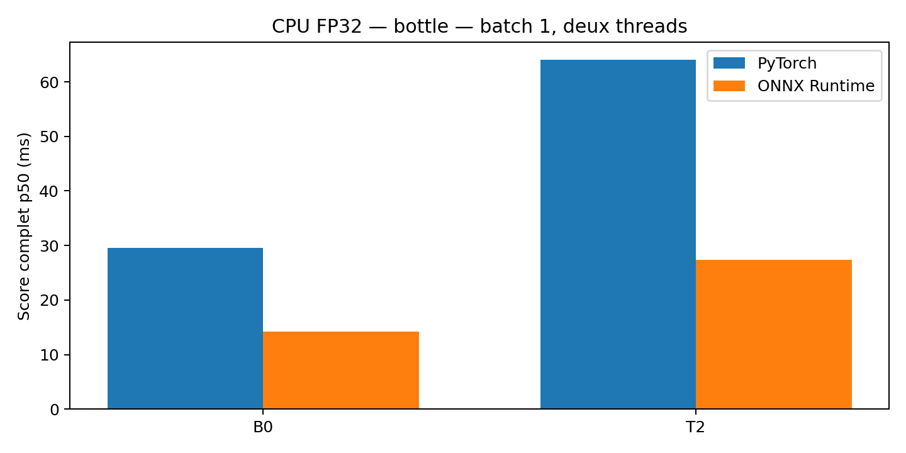
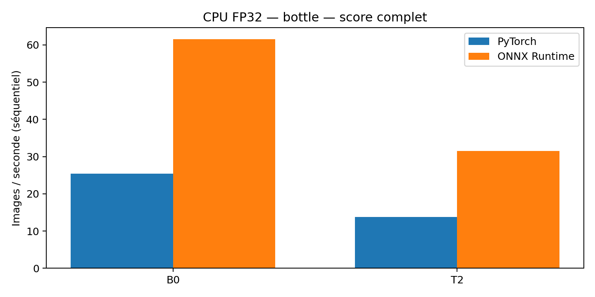

# ONNX Runtime — mesures CPU FP32

Mesures originales conservées et statistiques CSV vérifiées lors de la reprise
du 20 novembre 2026, sans relancer le benchmark. Voir le
[rapport de finalisation et les tests HTTP/navigateur](../../deployment/reports/onnx-finalization.md).

AMD Ryzen 5 5500U with Radeon Graphics; Docker Linux WSL2 x86_64; CPUExecutionProvider; FP32; 2 threads

Deux threads, batch 1, 20 warm-ups puis 100 mesures par moteur et condition. Ordre des moteurs alterné ; mêmes images val. Aucune image test, aucun seuil ajusté.

| Modele | PT p50 score ms | ORT p50 score ms | PT p95 ms | ORT p95 ms | PT/ORT moyenne | Parite |
| --- | ---: | ---: | ---: | ---: | ---: | --- |
| B0/bottle | 29.593 | 14.180 | 86.241 | 26.953 | 2.419 | passed |
| B0/hazelnut | 20.547 | 13.433 | 40.345 | 24.455 | 1.633 | passed |
| B0/leather | 18.886 | 12.566 | 35.266 | 21.916 | 1.480 | passed |
| T2/bottle | 64.050 | 27.388 | 134.372 | 67.127 | 2.292 | passed |
| T2/hazelnut | 74.578 | 31.739 | 237.305 | 171.577 | 1.676 | passed |
| T2/leather | 67.650 | 29.337 | 277.306 | 161.044 | 2.064 | passed |

## Statistiques par condition

| Modele | Condition | Moteur | Moyenne ms | p50 ms | p95 ms | Ecart-type ms | Images/s |
| --- | --- | --- | ---: | ---: | ---: | ---: | ---: |
| B0/bottle | forward | pytorch | 47.505 | 32.723 | 104.505 | 65.100 | 21.05 |
| B0/bottle | forward | onnxruntime | 12.869 | 10.701 | 30.861 | 7.174 | 77.70 |
| B0/bottle | score | pytorch | 39.308 | 29.593 | 86.241 | 27.908 | 25.44 |
| B0/bottle | score | onnxruntime | 16.249 | 14.180 | 26.953 | 9.190 | 61.54 |
| B0/hazelnut | forward | pytorch | 19.684 | 16.507 | 38.096 | 9.855 | 50.80 |
| B0/hazelnut | forward | onnxruntime | 11.094 | 9.791 | 16.718 | 4.039 | 90.14 |
| B0/hazelnut | score | pytorch | 24.121 | 20.547 | 40.345 | 16.995 | 41.46 |
| B0/hazelnut | score | onnxruntime | 14.775 | 13.433 | 24.455 | 4.320 | 67.68 |
| B0/leather | forward | pytorch | 36.884 | 16.533 | 73.908 | 147.149 | 27.11 |
| B0/leather | forward | onnxruntime | 15.583 | 9.599 | 30.125 | 27.545 | 64.17 |
| B0/leather | score | pytorch | 20.803 | 18.886 | 35.266 | 8.755 | 48.07 |
| B0/leather | score | onnxruntime | 14.059 | 12.566 | 21.916 | 5.155 | 71.13 |
| T2/bottle | forward | pytorch | 102.795 | 70.732 | 171.096 | 138.379 | 9.73 |
| T2/bottle | forward | onnxruntime | 34.163 | 28.135 | 61.775 | 24.870 | 29.27 |
| T2/bottle | score | pytorch | 72.716 | 64.050 | 134.372 | 32.626 | 13.75 |
| T2/bottle | score | onnxruntime | 31.722 | 27.388 | 67.127 | 14.739 | 31.52 |
| T2/hazelnut | forward | pytorch | 130.439 | 82.385 | 415.370 | 162.881 | 7.67 |
| T2/hazelnut | forward | onnxruntime | 56.045 | 31.489 | 193.610 | 76.813 | 17.84 |
| T2/hazelnut | score | pytorch | 137.509 | 74.578 | 237.305 | 267.145 | 7.27 |
| T2/hazelnut | score | onnxruntime | 82.037 | 31.739 | 171.577 | 278.441 | 12.19 |
| T2/leather | forward | pytorch | 119.764 | 62.649 | 234.865 | 300.537 | 8.35 |
| T2/leather | forward | onnxruntime | 35.986 | 26.143 | 69.863 | 35.168 | 27.79 |
| T2/leather | score | pytorch | 120.668 | 67.650 | 277.306 | 174.484 | 8.29 |
| T2/leather | score | onnxruntime | 58.454 | 29.337 | 161.044 | 100.523 | 17.11 |

Benchmark limité aux deux familles pilotes B0 et T2, chacune sur les trois catégories. A1/T0/T1 ne sont pas chronométrés : aucune accélération ne leur est attribuée.

## Chargement, mémoire et explication

| Modele | Chargement PT avec integrite ms | Session ORT ms | RSS processus Mo | Grad-CAM PT p50 ms | Grad-CAM PT p95 ms |
| --- | ---: | ---: | ---: | ---: | ---: |
| B0/bottle | 529.047 | 435.832 | 497.07 | Sans objet | Sans objet |
| B0/hazelnut | 614.854 | 307.588 | 570.86 | Sans objet | Sans objet |
| B0/leather | 505.043 | 179.688 | 523.50 | Sans objet | Sans objet |
| T2/bottle | 7112.404 | 337.380 | 722.95 | 101.556 | 601.792 |
| T2/hazelnut | 7881.946 | 556.073 | 810.80 | 106.714 | 542.785 |
| T2/leather | 8193.599 | 937.136 | 754.35 | 96.188 | 736.526 |

Les frontières de chargement diffèrent explicitement : PyTorch inclut les contrôles scientifiques et SHA ; ORT mesure la création/optimisation de session après admission. Aucun facteur de chargement n’est calculé.

## Artefacts et mesures brutes

[benchmark.csv](onnx/benchmark.csv) · [benchmark.json](onnx/benchmark.json) · [parity.json](onnx/parity.json) · [politique préalable](../../deployment/ONNX_PROTOCOL.md).

| Modele | Checkpoint entrainement Mo | Poids inference Mo | Graphe ONNX Mo |
| --- | ---: | ---: | ---: |
| B0/bottle | 2.378 | 0.798 | 0.785 |
| B0/hazelnut | 2.378 | 0.798 | 0.785 |
| B0/leather | 2.378 | 0.798 | 0.785 |
| T2/bottle | 41.630 | 16.328 | 16.025 |
| T2/hazelnut | 41.630 | 16.328 | 16.025 |
| T2/leather | 41.630 | 16.328 | 16.025 |

## Portee et limites

Score = normalisation commune + forward + calcul scientifique du score ; décodage/letterbox et HTTP exclus. Le forward seul est mesuré séparément dans benchmark.json et benchmark.csv. Les mesures Grad-CAM PyTorch sont séparées et ne servent jamais au facteur ONNX.
La mémoire RSS est un instantané du processus avec les deux réseaux présents, pas une mesure attribuable à un moteur. La taille du checkpoint peut inclure l’optimiseur ; state_dict et ONNX sont des tailles d’inférence séparées.
Machine partagée avec des services de fond ; aucun autre benchmark, test navigateur ou mesure intensive lancé par l’agent pendant ces mesures. Résultats locaux non assimilables à un benchmark de production isolé.
Les exports refusés sont listés dans les preuves de parité, sans tolérances élargies. Les nombres affichés dans React viennent exclusivement de ce benchmark.

## Preuves de parite par modele

| Modele | Exemples | Statut | Ecart score maximal | Changements de decision | Injustifies |
| --- | ---: | --- | ---: | ---: | ---: |
| A1/bottle | 42 | passed | 5.55954147e-08 | 0 | 0 |
| A1/hazelnut | 79 | passed | 1.93715096e-07 | 0 | 0 |
| A1/leather | 49 | passed | 1.1925472e-08 | 0 | 0 |
| B0/bottle | 42 | passed | 5.67084587e-08 | 1 | 0 |
| B0/hazelnut | 79 | passed | 2.36351497e-08 | 1 | 0 |
| B0/leather | 49 | passed | 1.31293768e-08 | 0 | 0 |
| T0/bottle | 126 | passed | 1.00135803e-05 | 2 | 0 |
| T0/hazelnut | 237 | passed | 1.1920929e-06 | 0 | 0 |
| T0/leather | 147 | passed | 1.39698386e-09 | 0 | 0 |
| T1/bottle | 126 | failed | 3.45110893e-05 | 0 | 0 |
| T1/hazelnut | 237 | passed | 5.9902668e-06 | 0 | 0 |
| T1/leather | 147 | passed | 1.78813934e-06 | 0 | 0 |
| T2/bottle | 126 | passed | 1.1920929e-07 | 2 | 0 |
| T2/hazelnut | 237 | passed | 7.15255737e-07 | 0 | 0 |
| T2/leather | 147 | passed | 1.1920929e-07 | 2 | 0 |

## Environnement effectif

```json
{
  "python": "3.11.9",
  "device": "cpu",
  "torch": "2.15.0+cpu",
  "numpy": "2.3.5",
  "scikit_learn": "1.8.0",
  "cuda_runtime": null,
  "torchvision": "0.29.2+cpu",
  "pillow": "13.0.0",
  "platform": "Linux-6.6.87.2-microsoft-standard-WSL2-x86_64-with-glibc2.36",
  "machine": "x86_64",
  "cpu_threads": 2,
  "deterministic_algorithms": true,
  "float32_matmul_precision": "highest",
  "mixed_precision": false,
  "onnx": "1.23.2",
  "onnxruntime": "1.32.0",
  "provider": "CPUExecutionProvider",
  "intra_op_threads": 2,
  "inter_op_threads": 1,
  "optimization": "ORT_ENABLE_ALL",
  "spinning": false
}
```

## Export refuse : T1/bottle

Sous Windows et Linux, le même normal de validation bottle/train/good/201.png et sa recette synthétique normale produisent un écart de score hors politique. Aucun changement de décision, mais cela ne suffit pas à admettre le graphe. Les autres recettes ne sont pas utilisées pour recalibrer ou élargir les tolérances. Le moteur PyTorch reste disponible.
Les tenseurs logits passent leur tolérance distincte, mais le score sigmoid dépasse sa propre limite : c’est une incompatibilité numérique mesurée entre les kernels FP32, pas une autorisation de changer les seuils. La cause algorithmique exacte de l’écart entre kernels n’est pas isolée ici.





## Tailles des quinze exports locaux

Tailles lues dans les metadonnees existantes, sans nouvel export. Le graphe T1/bottle reste exclu de l API.

| Modele | Checkpoint Mo | Poids inference Mo | Graphe ONNX Mo | Statut Linux |
| --- | ---: | ---: | ---: | --- |
| A1/bottle | 33.168 | 11.078 | 11.023 | passed |
| A1/hazelnut | 33.168 | 11.078 | 11.023 | passed |
| A1/leather | 33.168 | 11.078 | 11.023 | passed |
| B0/bottle | 2.378 | 0.798 | 0.785 | passed |
| B0/hazelnut | 2.378 | 0.798 | 0.785 | passed |
| B0/leather | 2.378 | 0.798 | 0.785 | passed |
| T0/bottle | 48.563 | 16.328 | 16.025 | passed |
| T0/hazelnut | 48.563 | 16.328 | 16.025 | passed |
| T0/leather | 48.563 | 16.328 | 16.025 | passed |
| T1/bottle | 16.327 | 16.328 | 16.025 | failed |
| T1/hazelnut | 16.327 | 16.328 | 16.025 | passed |
| T1/leather | 16.327 | 16.328 | 16.025 | passed |
| T2/bottle | 41.630 | 16.328 | 16.025 | passed |
| T2/hazelnut | 41.630 | 16.328 | 16.025 | passed |
| T2/leather | 41.630 | 16.328 | 16.025 | passed |
